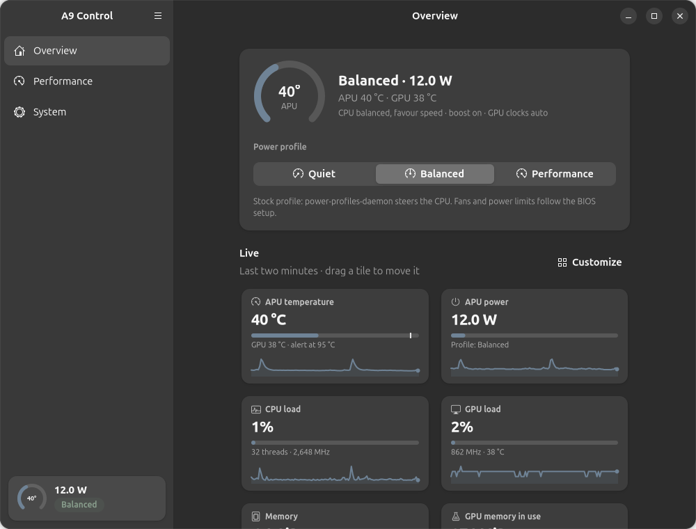
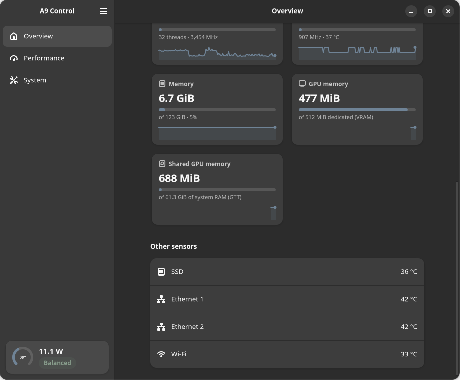
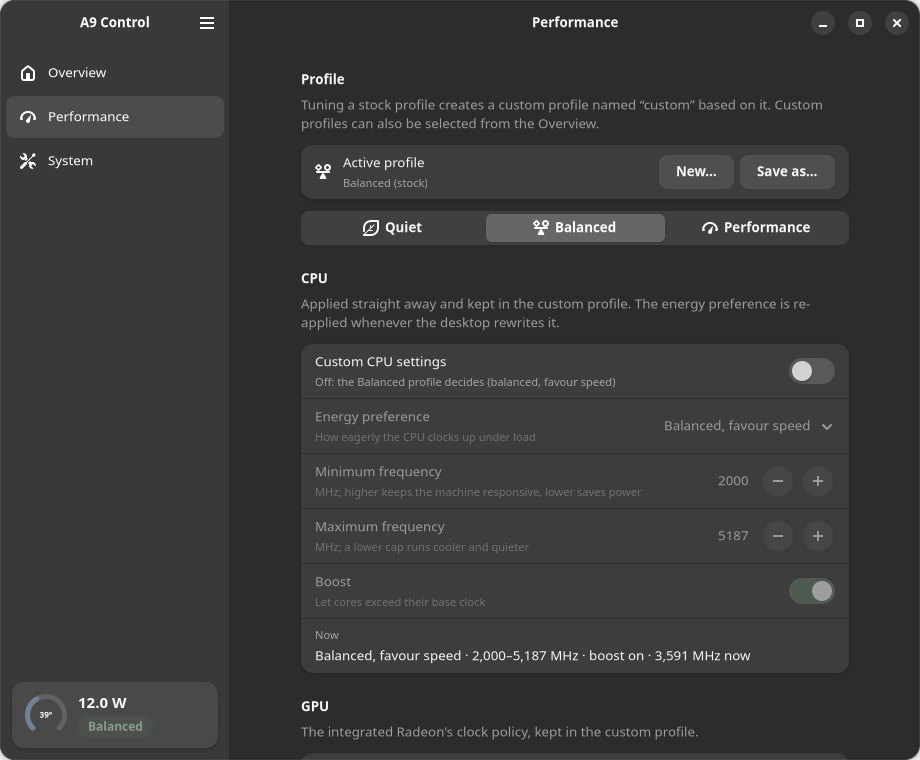
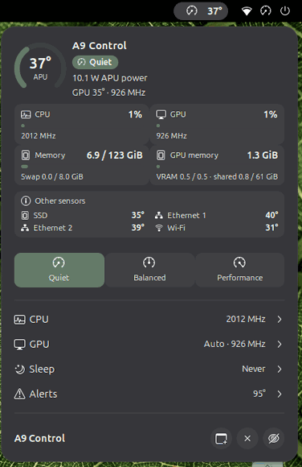
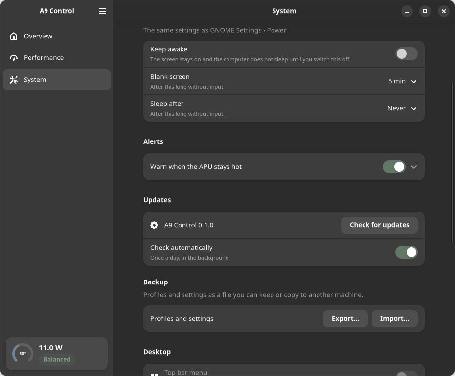

# A9 Control

Performance profiles, CPU and GPU tuning, and live monitoring for the
**GEEKOM A9 Mega** (AMD Ryzen AI Max+ 395) on Linux.

An app, a panel menu for **GNOME** and **KDE Plasma**, and an `a9`
command-line tool, all talking to a small system service that holds the
privileges so nothing else has to. No kernel module, no Secure Boot key.



## Install

One line, on Ubuntu 26.04 (made and tested on 26.04.1), Fedora 42+, or
Arch-based systems such as CachyOS (GNOME or KDE Plasma 6):

```sh
curl -fsSL https://raw.githubusercontent.com/wabibito/a9-control/main/install.sh | sh
```

It picks the right package for your system, asks for your password once, and
starts the service. Or download the package from [Releases](../../releases)
and install it by hand:

```sh
sudo apt install ./a9-control_*_all.deb              # Ubuntu / Debian
sudo dnf install ./a9-control-*.noarch.rpm           # Fedora / RHEL
sudo pacman -U ./a9-control-*-any.pkg.tar.zst        # Arch / CachyOS / EndeavourOS
```

### Two versions: pick one

The app, the top-bar menu, the Plasma widget and the `a9` command are the same
in both. They differ in the background service that holds the privileges:

* `a9-control` (Python): installs on Ubuntu, Fedora and Arch.
* `a9-control-rs` (Rust, Ubuntu 26.04 on x86_64): the same service compiled,
  using a few megabytes of memory and next to no CPU while it runs.

```sh
sudo apt install ./a9-control-rs_*_amd64.deb      # replaces a9-control; settings carry over
sudo apt install a9-control                       # and back
```

**Log out and back in once after installing.** GNOME only picks up the top-bar
menu at login; the app enables it for you. On KDE Plasma the app adds its
widget to your panel the first time it starts.

## What it does

### An Overview you arrange yourself

Choose which tiles you see and **drag them into the order you want**, or use
**Customize** to switch tiles and cards on and off. Twenty-three kinds of tile
to pick from, for the whole machine or one device, among them:
APU temperature and power, CPU load and clock, GPU load, clock and temperature,
memory, GPU memory, room for models, dedicated and shared GPU memory, memory
clock and the NPU, plus cards for the apps using the GPU and the SSD, Ethernet
and Wi-Fi temperatures. Every tile has a two-minute graph, kept by the service,
so one you add opens with its history drawn. **The top-bar menu and the Plasma
widget show the same layout**: arrange it once, see it everywhere.



### Every GPU, every reading

The APU's own Radeon and **any AMD or NVIDIA GPU you add** (in a slot, or an
eGPU over USB4 or OCuLink) each get their own tiles: load, clock, temperature,
power, memory and video engine. NVIDIA cards are read through `nvidia-smi` when
NVIDIA's driver is installed. Besides the APU and GPU, tiles cover:

* **Per-core clocks and activity** for all 16 cores, as a strip.
* **Power split**: CPU cores, GPU and the whole package.
* **Throttling**: whether a power limit or a temperature is holding the chip
  back, and which.
* **Memory bandwidth**: what the CPU, GPU and NPU read from and write to RAM.
* **Network and disk** throughput, for all ports and drives or one at a time.
* **Video engine** load (encode and decode) and **pressure stall** (time spent
  waiting on CPU, memory or I/O).

**Rename** any GPU ("iGPU", "eGPU") and any tile to what makes sense to you; the
names show in the app, the menu and the widget. In a terminal: `a9 devices`,
`a9 rename gpu 1 iGPU`, `a9 rename tile mem_bw "DRAM traffic"`.

### Made for local AI

The A9 Mega's GPU borrows its memory from the 128 GB of system RAM, so the
numbers that matter when you run models are different:

* **Room for models**: how much more the GPU can take right now, bounded by the
  RAM the rest of the system leaves free.
* **GPU memory in use**, split into the dedicated carve-out and the shared pool.
* **Using the GPU**: each process holding GPU memory (an `ollama` or
  `llama-server` service included) and its share of GPU time.
* Memory and fabric clocks, and the NPU.

```sh
a9 ai        # the same in a terminal
```

### Profiles and tuning

**Quiet, Balanced and Performance** are the same profiles as your desktop's
power menu, and the two always agree. On top of them, **custom profiles** set:

* the CPU's energy preference,
* a minimum and a **maximum clock** (a lower cap is the easiest way to keep the
  machine quiet under a long load),
* boost (turbo) on or off,
* the GPU's clock policy: by load, pinned low, or pinned high.

Tuning while a stock profile is active creates a profile named `custom`;
save it under any name to keep it. Your settings stay in force even when the
desktop rewrites them.



### Top-bar menu

The APU temperature in the top bar, and a dashboard one click away: a gauge,
your Overview's tiles and cards, profile buttons, and CPU, GPU, sleep and alert
settings. It scrolls when you pick more tiles than the screen has room for, and
follows the shell's accent colour and light/dark style.



### KDE Plasma panel widget

The same dashboard, layout and controls as a Plasma 6 panel widget.

### System

Accent colour and light/dark style shared by the app, menu and widget; when
the screen blanks and the computer sleeps, with a keep-awake switch; a warning
when the APU stays hot; export and import of your profiles; updates and
uninstall.



### What it does not do

The A9 Mega's firmware gives Linux no way to control its **fans** or the
APU's **power limits**. Set those in the BIOS setup. A9 Control reads what
the hardware reports and tunes what the kernel exposes; it does not poke
firmware registers.

### Staying up to date

The app checks for a new release once a day (System → Updates) and installs it
with one password prompt. From a terminal: `a9 update`.

### Command line

```sh
a9 status                          # everything at a glance
a9 ai                              # room for models and what is using the GPU
a9 overview --add mclk             # change the Overview (app, menu and widget)
a9 monitor                         # live temperature / power / load
a9 use performance                 # switch profile (stock or custom)
a9 cpu --max-mhz 3500 --boost off  # cap the CPU
a9 gpu low                         # GPU clock policy: auto, low, high, default
a9 profile save-as quiet-desk      # keep the current tuning under a name
a9 alerts --temp 95 --seconds 60   # warn when the APU stays hot
a9 sleep --keep-awake on           # never blank or sleep until switched off
a9 export profiles.json            # back up profiles and settings
a9 history usage.csv               # recorded telemetry as CSV
```

## How it is put together

A system service (`a9-control.service`) owns the hardware and answers on
D-Bus. The app, the menu, the widget and the `a9` command are ordinary
programs that ask it; every change is checked by polkit, and nothing on the
system has its permissions loosened. Profiles switch through
power-profiles-daemon so the desktop's power menu stays in step.

## Requirements

* GEEKOM A9 Mega
* Ubuntu 26.04 (tested on 26.04.1), Fedora 42 or newer, or an Arch-based distribution
* GNOME or KDE Plasma 6 for the menu or widget (the app and CLI work anywhere)
* power-profiles-daemon (installed by default on Ubuntu and Fedora)

## What's new

### 0.1.0

First release.

## Uninstall

In the app: **System → Remove → Uninstall…**. Or:

```sh
sudo apt remove a9-control      # add --purge to delete saved profiles
sudo dnf remove a9-control
sudo pacman -R a9-control
```

## License

Copyright 2026 NA Research. Licensed under the Apache License 2.0.
